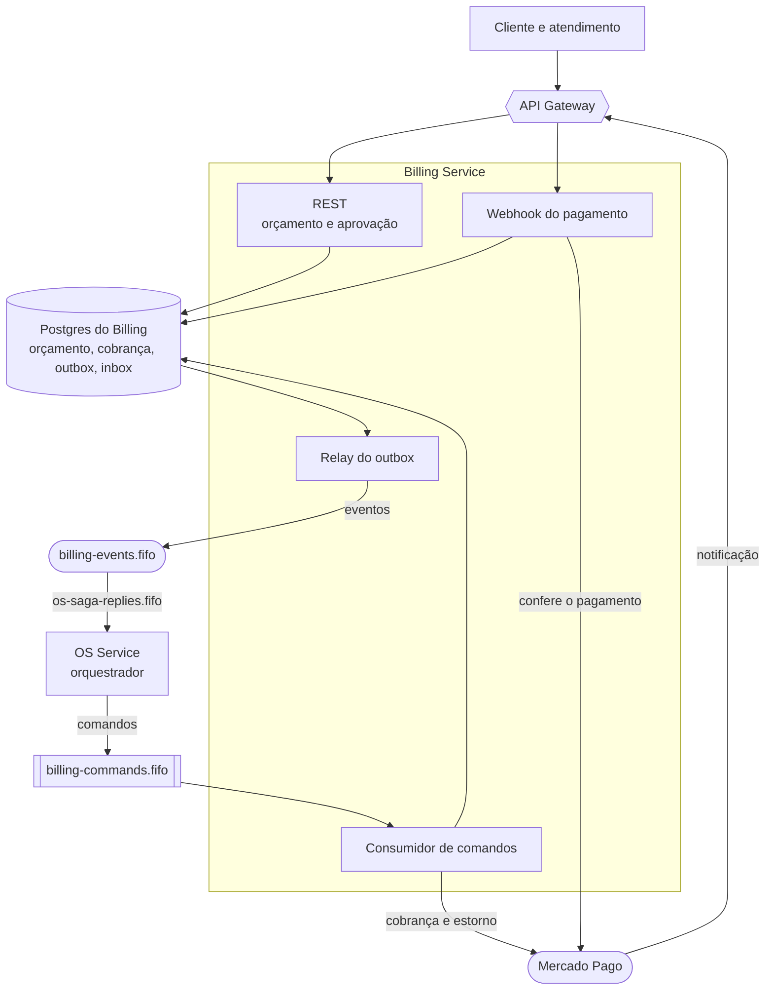
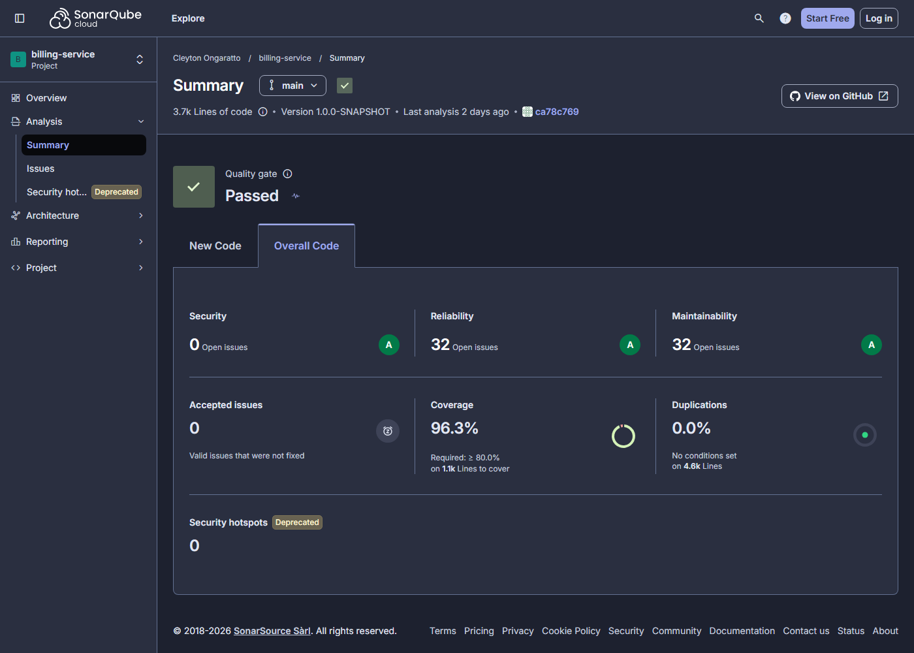

# fiap-fase4-billing-service

[](https://sonarcloud.io/summary/overall?id=CleytonOngaratto_fiap-fase4-billing-service&branch=main)
[](https://sonarcloud.io/summary/overall?id=CleytonOngaratto_fiap-fase4-billing-service&branch=main)

Billing Service da Fase 4 do Tech Challenge (FIAP SOAT): orçamento a partir do diagnóstico, aprovação pelo
cliente e pagamento pelo Checkout Pro do Mercado Pago. Quarkus.

Arquitetura em
[fiap-fase4-os-service/docs/arquitetura](https://github.com/CleytonOngaratto/fiap-fase4-os-service/tree/main/docs/arquitetura)
— em especial o [ADR-008](https://github.com/CleytonOngaratto/fiap-fase4-os-service/blob/main/docs/arquitetura/adr/ADR-008-pagamento-mercado-pago.md),
que explica as decisões de pagamento.

## O papel na Saga

A Saga é **orquestrada**, e o orquestrador vive no OS Service. Este serviço é **participante**: recebe
comandos numa fila FIFO própria e responde com eventos num tópico FIFO próprio. Nunca decide o próximo passo
do processo, e nunca lê o banco de outro serviço.



### Comandos que consome

| Comando | O que faz | Responde |
|---|---|---|
| `CreateBudget` | cria o orçamento a partir do snapshot precificado | `BudgetCreated` ou `BudgetCreationFailed` |
| `RequestPayment` | cria a preferência no Mercado Pago e guarda o link | `PaymentRequested` ou `PaymentRequestFailed` |
| `CancelBudget` | cancela o orçamento (compensação) | `BudgetCanceled` |
| `CancelPayment` | cancela a cobrança pendente (compensação) | `PaymentCanceled` |
| `RefundPayment` | estorna a cobrança confirmada (compensação) | `PaymentRefunded` |

### Eventos que publica

`BudgetCreated` · `BudgetCreationFailed` · `BudgetApproved` · `BudgetRejected` · `BudgetCanceled` ·
`PaymentRequested` · `PaymentRequestFailed` · `PaymentAttemptRejected` · `PaymentConfirmed` ·
`PaymentCanceled` · `PaymentRefunded`

Três regras valem para todos eles:

1. **Comando responde sempre, uma vez por `messageId`.** Quem decide se a mensagem já foi tratada é a
   *inbox*, não o estado do agregado: um `CancelBudget` para orçamento já cancelado **ainda** publica
   `BudgetCanceled`, senão a saga ficaria esperando para sempre uma confirmação que não viria.
2. **Nenhuma publicação fora de transação.** O evento é gravado na `saga_outbox` na **mesma** transação que
   muda o estado; um relay agendado drena a tabela e publica no SNS.
3. **O webhook é a exceção da regra 1**: ali não existe `messageId`, então o evento só sai quando a
   transição de fato mudou o estado — é o único freio contra a reentrega do provedor gerar evento duplicado.

## Tecnologias

| Tecnologia | Versão | Uso |
|---|---|---|
| Java | **17** | linguagem; imagem `eclipse-temurin:17-jre-jammy` |
| Quarkus | **3.26.3** | REST, CDI, configuração e agendamento |
| Hibernate ORM com Panache | 7.1.0 | persistência |
| Flyway | 11.11.2 | migrations |
| PostgreSQL | 16, driver 42.7.7 | banco do serviço |
| AWS SDK for Java v2 (SQS e SNS) | 2.32.4 | fila de comandos e tópico de eventos |
| Mercado Pago, Checkout Pro | API REST | cobrança, confirmação e estorno ([ADR-008](https://github.com/CleytonOngaratto/fiap-fase4-os-service/blob/main/docs/arquitetura/adr/ADR-008-pagamento-mercado-pago.md)) |
| SmallRye JWT | 4.6.2 | valida o token RS256 |
| SmallRye OpenAPI e Swagger UI | 4.0.12 | especificação da API |
| Micrometer com Prometheus | 1.14.7 | métricas |
| New Relic Java Agent | 9.4.0 | APM, traço distribuído e logs |
| JUnit 5 · Mockito · REST Assured | 5.13.4 · 5.18.0 · 5.5.6 | testes de unidade e de API |
| Testcontainers · WireMock | 1.21.3 · 3.13.2 | testes com Postgres e filas reais, e o Mercado Pago simulado |
| ArchUnit | 1.3.0 | regras de arquitetura |
| JaCoCo | 0.8.12 | cobertura e gate do build |
| SonarCloud (`sonar-maven-plugin`) | 5.8.0.7211 | análise de qualidade no CI |
| Trivy | 0.58.0 | varredura de vulnerabilidades no CI |
| ElasticMQ | 1.7.1 | filas no ambiente local e nos testes |
| Terraform · provider AWS · provider random | 1.15.4 · 6.57.1 · 3.9.1 | infraestrutura do serviço |
| Amazon EKS · kubectl | 1.36 (medido em 2026-10-11) · 1.35.9 | execução e deploy |
| GitHub Actions | — | CI/CD |

## API

| Rota | Quem pode | Resposta |
|---|---|---|
| `GET /billing/v1/budgets?work_order_id={id}` | o **dono** do orçamento (claim `cpf`) ou ADMIN | o mesmo do `GET` por id, para quem conhece a OS e ainda não o id do orçamento; **400** sem o parâmetro, **404** sem orçamento |
| `GET /billing/v1/budgets/{id}` | o **dono** do orçamento (claim `cpf`) ou ADMIN | orçamento, itens, total e — quando já existe — o link de pagamento |
| `POST /billing/v1/budgets/{id}/approve` | o dono | **202**; a cobrança nasce de forma assíncrona |
| `POST /billing/v1/budgets/{id}/reject` | o dono | **202** |
| `POST /billing/v1/webhooks/mercadopago` | **público**, sem JWT | 200; **401** se a assinatura não confere |
| `GET /billing/v1/info` | público | nome e versão (é o smoke do deploy) |

Aprovar exige três condições, nesta ordem: ser o dono (**403**), o orçamento estar `PENDING_APPROVAL`
(**409**) e o prazo de aprovação não ter vencido (**409**).

O webhook responde **200 para tópico que não é de pagamento**: qualquer outra coisa faz o Mercado Pago
reentregar para sempre. A única proteção da rota é a assinatura `x-signature`, comparada em tempo constante
e **negando quando o segredo não está configurado**.

### Swagger e Postman

| O quê | Onde |
|---|---|
| Swagger UI, com o [ambiente local](#ambiente-local) de pé | `http://localhost:8081/swagger-ui/` |
| OpenAPI em tempo de execução | `http://localhost:8081/billing/v1/q/openapi` |
| Especificação versionada, gravada pelo build | [`docs/api/openapi.yaml`](docs/api/openapi.yaml) |
| Collection do Postman | [`docs/api/billing.postman_collection.json`](docs/api/billing.postman_collection.json) |
| Ambiente de exemplo, com os valores vazios | [`docs/api/gateway.example.postman_environment.json`](docs/api/gateway.example.postman_environment.json) |

O job `build` falha se o `openapi.yaml` versionado divergir do gerado. O Swagger UI e o `/q/*` não passam pelo API Gateway, e as
rotas públicas são as da allowlist, em
[`session/locals.tf`](https://github.com/CleytonOngaratto/fiap-fase4-auth-serverless/blob/main/session/locals.tf).

Um orçamento só existe depois que a saga chega ao `CreateBudget`. Preencha `workOrderId` e `cpf` com os da ordem de serviço, ou
rode antes o [fluxo completo](https://github.com/CleytonOngaratto/fiap-fase4-os-service#como-usar-a-collection) do os-service.
`baseUrl` é o valor de `/fase4/apigw/url`, e o token do cliente vem do `POST /auth`. Rode uma pasta por vez, pelo Collection
Runner ou pelo Newman: aprovar e rejeitar são caminhos alternativos do mesmo orçamento, e as esperas não funcionam no "Send".

## "Atualização do status da OS após o pagamento"

A linha do enunciado é atendida **sem** este serviço escrever na OS. Ao confirmar o pagamento, o Billing
publica `PaymentConfirmed`; o orquestrador, no OS Service, é quem dá baixa nas peças e move o status. Nenhum
serviço escreve no banco de outro — o que atravessa a fronteira é mensagem.

## Ambiente local

```
docker compose up -d
```

Sobe quatro contêineres: a aplicação, o Postgres 16, um **ElasticMQ** com a fila `billing-commands.fifo` e a
DLQ dela, e um **WireMock** fazendo as vezes do Mercado Pago. A aplicação atende em `http://localhost:8081`.

Antes de subir, crie `./secrets/publicKey.pem` (a chave pública que valida o JWT). Esse diretório está fora
do git.

Duas coisas do ambiente local merecem nota:

- **O relay não publica no SNS em local.** O ElasticMQ não emula SNS, e apontar o relay para a fila de outro
  serviço poria a fila do OS na configuração deste, contra "o tópico é o contrato". Em local o relay registra
  o envelope em log (`BILLING_EVENTS_PUBLISH_TO_LOG=true`), e isso é coberto por teste.
- **O WireMock devolve o id do caminho como `external_reference`.** Para exercitar o webhook localmente,
  mande `data.id` igual ao **id do orçamento**: o stub ecoa esse valor, e a notificação encontra a cobrança.

## Testes

```
./mvnw clean verify
```

Exige **Docker ligado**: o teste de integração sobe Postgres 16 e ElasticMQ por Testcontainers.

| Camada | O que prova |
|---|---|
| Testes puros | domínio, casos de uso, codec, consumidor, relay, gateways, controllers e o adapter do Mercado Pago contra WireMock |
| `@QuarkusTest` | as rotas de verdade: 200/403/404 no `GET`, 202 no `approve`/`reject`, **409** depois do prazo, 401 sem token e 401 no webhook sem assinatura |
| Testcontainers | **as migrations V1 e V2 aplicadas pelo Flyway em PostgreSQL real** e as constraints recusando o segundo orçamento da mesma OS e a notificação repetida |

### A exclusão do JaCoCo, e por quê

O gate é `BUNDLE LINE >= 0,80`, e há **uma** exclusão, estreita de propósito:

```
**/persistence/*PanacheRepository.class
```

Os repositórios Panache são o único grupo que teste puro não salva: repositório mockado **nunca parseia
HQL**. Foi exatamente esse o bug mais caro do bloco anterior — uma consulta escrita com o nome da coluna
(`work_order_id`) em vez do nome do campo (`workOrderId`) passou verde no teste e quebrou em produção. Medir
uma classe que o teste não consegue exercitar de verdade compraria cobertura falsa; o comportamento desses
repositórios é provado no teste de integração, contra Postgres real.

As **entidades** Panache ficam no mesmo pacote e **continuam medidas** — essas, teste puro cobre.

## Evidência de cobertura

| Medida | Valor | Onde se lê |
|---|---|---|
| `coverage` do SonarCloud, o número do badge (soma linhas e condições) | **96,3%** | API do SonarCloud, lida em 2026-11-09 |
| `line_coverage` do SonarCloud | 97,7% | idem |
| `branch_coverage` do SonarCloud | 91,0% | idem |
| Testes | 228, nenhuma falha | `./mvnw clean verify`, em 2026-11-09 |
| JaCoCo `LINE`, o gate do build (mínimo de 80%) | **97,73%** (1035 de 1059 linhas) | idem |

O badge e o gate medem coisas diferentes: o `coverage` do Sonar soma linhas e condições, e o gate do JaCoCo olha só linhas. Por
isso os números não coincidem. A exclusão descrita acima vale para os dois.



## Deploy

| Workflow | Gatilho | O que faz |
|---|---|---|
| [`maven-ci.yml`](.github/workflows/maven-ci.yml) | PR e `push` na `main` | build, testes, JaCoCo, análise no SonarCloud (`build` e `SonarCloud Code Analysis` são checks obrigatórios) e Trivy |
| [`terraform.yml`](.github/workflows/terraform.yml) | PR → `fmt-validate` (check obrigatório) + `plan` · `push` na `main` com mudança em `terraform/` → `apply` · `workflow_dispatch` → `plan`/`apply`/`destroy` | a infraestrutura do serviço, em [`terraform/`](terraform/): **RDS PostgreSQL** próprio, target group `ip`, a regra `/billing/v1/*` no ALB interno e a **fila de comandos** que o orquestrador usa para falar com este serviço |
| [`cd.yml`](.github/workflows/cd.yml) | `push` na `main` (fora `*.md`, `docs/` e `terraform/`) e `workflow_dispatch` | testes → imagem no ECR (tag = SHA do commit) → manifestos no EKS → smoke: alvos `healthy` no target group e, com a borda de pé, `GET /billing/v1/info` → **200** pelo API Gateway |

**O merge aplica.** Um merge que mude `terraform/` cria ou altera recursos na AWS — só com a sessão do
laboratório ligada e com o teardown na mesma sessão. Num merge com código e `terraform/` os dois workflows
rodam juntos: o `cd.yml` espera no SSM o target group, os cinco parâmetros do RDS e a URL da fila (até
25 min) e falha dizendo quem publica cada um.

## Contrato no SSM

| Lê | De quem |
|---|---|
| `/fase4/vpc/id`, `/fase4/vpc/private-subnets`, `/fase4/eks/node-sg-id`, `/fase4/alb/listener-arn` | plataforma ([fiap-fase4-infra-k8s](https://github.com/CleytonOngaratto/fiap-fase4-infra-k8s)), no `terraform/` |
| `/fase4/ecr/billing/repo-url`, `/fase4/eks/cluster-name`, `/fase4/alb/sg-id`, `/fase4/sns/billing-events/topic-arn` | plataforma, no `cd.yml` |
| `/fase4/apigw/url` | [fiap-fase4-auth-serverless](https://github.com/CleytonOngaratto/fiap-fase4-auth-serverless), no smoke do `cd.yml` |
| `/fase4/jwt/public-key` | bootstrap manual — o Billing **valida** o JWT e nunca o assina, então a chave privada não entra neste cluster |
| `/fase4/mercadopago/access-token`, `/fase4/mercadopago/webhook-secret` | bootstrap manual (sobrevivem ao teardown) |
| `/fase4/newrelic/license-key` | bootstrap manual |

| Publica | Conteúdo |
|---|---|
| `/fase4/billing/alb/target-group-arn` | target group que o `TargetGroupBinding` liga aos pods |
| `/fase4/billing/rds/{endpoint,port,db-name,username,password}` | o banco próprio deste serviço; a senha é `SecureString` e muda a cada `apply` |
| `/fase4/billing/sqs/commands-queue-url` | **fila de comandos deste serviço**, lida pelo `cd.yml` do [fiap-fase4-os-service](https://github.com/CleytonOngaratto/fiap-fase4-os-service): é para lá que o orquestrador envia `CreateBudget`, `RequestPayment`, `CancelBudget`, `CancelPayment` e `RefundPayment` |

A fila é provisionada aqui porque **a fila pertence a quem a consome**; o tópico de eventos, por ser contrato
público, pertence à plataforma. Nenhuma política de recurso na fila: quem escreve são os pods do OS, na mesma
conta, autorizados por IAM.

## Kubernetes

Tudo no namespace **`billing`** ([`k8s/application/`](k8s/application/)): ServiceAccount própria sem token
montado, ConfigMap, três Secrets gerados pelo `cd.yml` a cada deploy (`-db`, `-app` e `-jwt`), Deployment com
HPA, Service `ClusterIP` e o `TargetGroupBinding` que registra os pods no target group do ALB interno.

Os Secrets são **regenerados a todo deploy** porque a senha do RDS muda a cada `apply`. A URL da fila e o ARN
do tópico entram no ConfigMap por `sed`, a partir de placeholders — e o `cd.yml` **falha** se o placeholder
sumir, que é como alguém hardcodaria o valor sem perceber.

O namespace tem a label `elbv2.k8s.aws/pod-readiness-gate-inject: enabled`: o pod só fica pronto quando o
alvo dele está `healthy` no target group, e o `preStop` segura o encerramento enquanto o ALB drena o alvo.

A entrada é sempre pelo API Gateway; `/q/*` (health, métricas, OpenAPI) só dentro da VPC.

## Decisões

| ADR | Decisão |
|---|---|
| [ADR-001](https://github.com/CleytonOngaratto/fiap-fase4-os-service/blob/main/docs/arquitetura/adr/ADR-001-saga-orquestrada.md) | Saga orquestrada, com este serviço como participante |
| [ADR-006](https://github.com/CleytonOngaratto/fiap-fase4-os-service/blob/main/docs/arquitetura/adr/ADR-006-mensageria.md) | Mensageria: SNS FIFO, SQS FIFO e outbox transacional |
| [ADR-008](https://github.com/CleytonOngaratto/fiap-fase4-os-service/blob/main/docs/arquitetura/adr/ADR-008-pagamento-mercado-pago.md) | Pagamento pelo Checkout Pro do Mercado Pago |
| [ADR-011](https://github.com/CleytonOngaratto/fiap-fase4-os-service/blob/main/docs/arquitetura/adr/ADR-011-bancos-sql-e-nosql.md) | PostgreSQL próprio, numa instância RDS só deste serviço |
